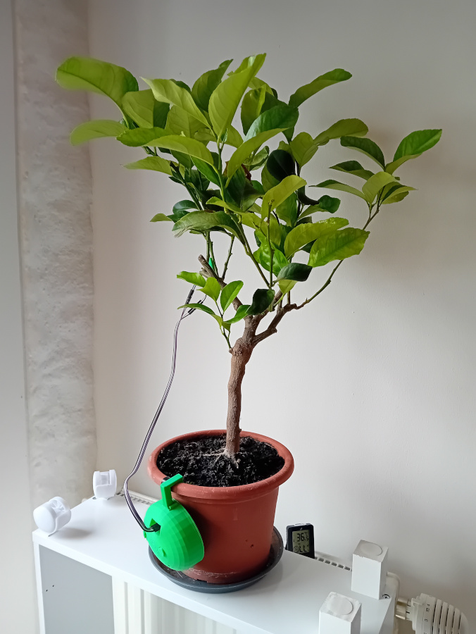
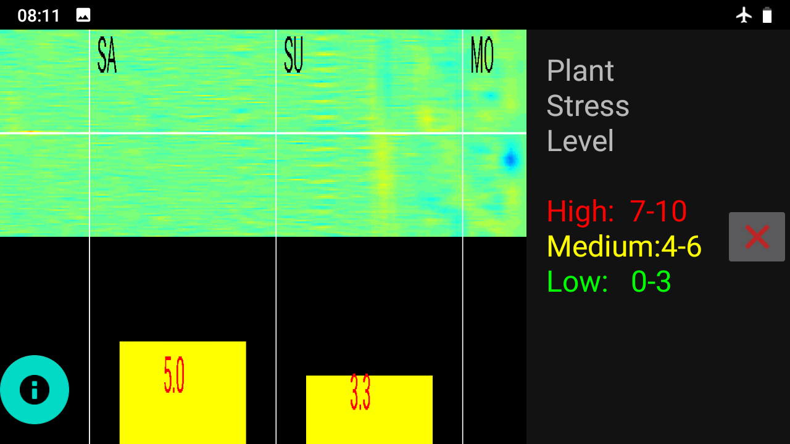
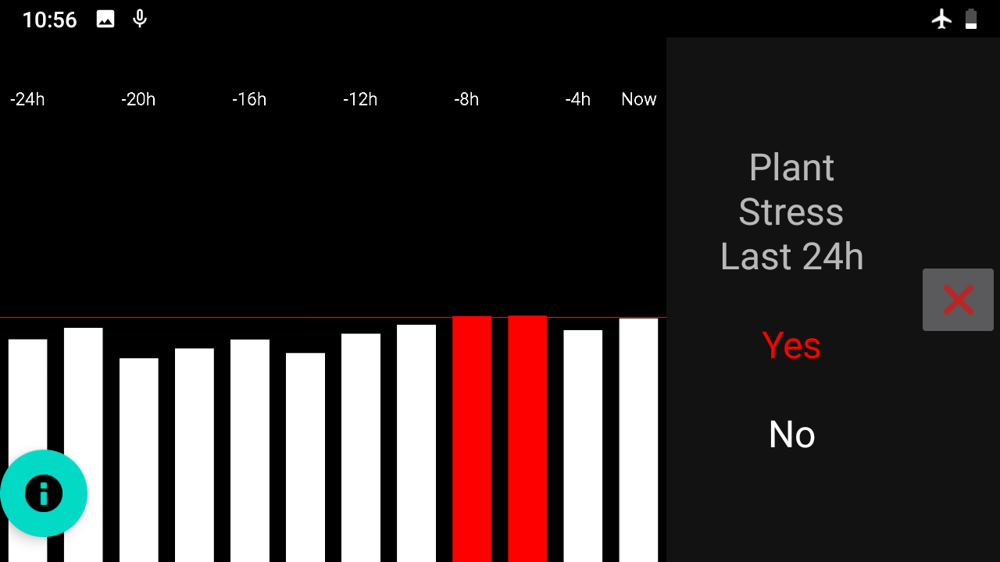

## Stress Detector for Houseplants

Plant stress is a well defined concept. Stress happens when a plant 
organism is overwhelmed by accumulating oxygen radicals. In that 
situation the normal biochemical processess that neutralize oxygen 
radicals cannot cope and the plant's cells are damaged. When stress 
persists this damage can be permanent and lead to widespread cell death. 
The plant will stop growing, will not flower, not reproduce and finally 
die.

Stress is detectable biochemically well before actual symptoms are
visible, but this requires a substantial amount of plant tissue to be
sacrificed for analysis, making it infeasible for houseplants.

Stress is also detectable indirectly by measuring the negative impact
it has on the photosynthetic processes of the plant. During times
of high stress photosynthesis slows down or may come to a halt completely, 
even if light is abundant. This can be measured with expensive optical
equipment without damaging any plant tissue, but the price of these
devices is too high to be of interest to houseplant owners.

We at the Phyclops Project have found a way to detect plant stress
using tiny electrodes attached to a branch or stem. Since these 
electrodes are small they are harmless and cause no significant damage 
to plant tissue. Through them we can recognize specific patterns in the 
electrical signals plants send through their bodies to communicate, 
very similar to the electrical singnaling that happens in animal 
nervous systems.

Our method allows you to see plant stress within the first two to four 
hours after it first appears and usually days or weeks before any physical 
symptoms such as leafloss or wilting become visible, giving you
enough time to identify and remove the most likely source of the stress. 

Our plant stress detector, the [link pending ]PhyclopsHOME-SDv01[link pending], 
is best used right after you have bought a new plant for your home and need to 
find the right spot for it. Pick a place for your new plant, connect the 
detector and for the next two to three days [observe the stress levels
with the App](/App.html). If stress is low, you have found the right spot 
and can disconnect the detector. If stress is high you should move 
the plant to a different spot and again monitor stress levels for two 
to three days. Do this until you have found a spot where the stress 
levels are lowest. That is the place your plant likes best.

If, like us, you are curious and want to know which changes to your 
home environment the new plant considers stressful, leave the detector 
connected and observe how your plant responds. You will be 
amazed by this simple but powerful insight into a plant's life.

This is science, not superstition!
